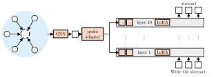

# Neighborhood-Based Node Text Generation with Graph Neural Networks and Large Language Models

Code and evaluation results of my BSc thesis at the Budapest University of Technology and
Economics (BME VIK), Department of Telecommunications and Artificial Intelligence.

This project investigates whether text can be generated for a new node from its known graph
neighbourhood, using continuous vectors to condition a language model. The task is studied on a
citation graph: the abstract of a paper is generated from the papers it cites, while its own
title and abstract are withheld.

## How it works



([PDF version](diagrams/method_overview.pdf))

1. **Data.** The ogbn-arxiv citation graph is enriched with citation records from Semantic
   Scholar. The title and abstract of every paper are embedded with `voyage-4-large`.
2. **GNN estimator.** A one-layer GATv2 network estimates the embedding of the target paper from
   the embeddings of the papers it cites. The target's own embedding is excluded from the GNN
   input.
3. **Prefix adapter.** The estimate is turned into key and value vectors for every attention
   layer of Qwen3-14B (prefix tuning).
4. **Reader.** Qwen3-14B, adapted with LoRA, generates the abstract from the prefix and a fixed
   instruction that is identical for every paper.

The reader and the GNN estimator are first trained separately and then fine-tuned jointly.

## Findings

The model generates coherent abstracts that, in successful cases, reflect the target paper's
research area, problem and task. Learned neighbourhood aggregation improves on averaging the
reference embeddings, while joint fine-tuning gives no consistent further improvement. Exact
methods and findings are not reliably recovered.

Detailed results: [`notebooks/ablations.ipynb`](notebooks/ablations.ipynb).

## Repository layout

```
src/
  data/          ogbn-arxiv download, Semantic Scholar pipeline (s2/), joint graph
  adapter/       GNN estimator, prefix adapter, reader, training and generation
  evaluation/    text similarity and the LLM judge
notebooks/       embeddings, data statistics, evaluation results and ablations
experiments/     generated abstracts and their scores
hpc/komondor/    container definition and job scripts for the Komondor supercomputer
diagrams/        the figures used in the thesis
```

The generated abstracts and scores of every evaluated configuration are in `experiments/`; the
notebooks in `notebooks/` analyse them.

## Reproducing

The datasets, embeddings and model checkpoints are not included. The node sets of the final
run are: `data/frozen/` holds the ids of the 945 evaluation papers, the 806 validation papers and
the training papers. Paths are relative to the repository root.

**Environment.** The data, embedding and evaluation steps run in a local Python environment:
`src/data/s2/requirements.txt` for the Semantic Scholar scripts, plus `ogb`, `torch`,
`torch_geometric` and `voyageai` for the download and embeddings, and `rouge-score`, `bert-score`,
`openai` and `python-dotenv` for the evaluation. Training and generation run in the Singularity
container built from `hpc/komondor/containers/adapter-qwen-gpu.def`, which pins the library
versions (transformers 4.51.3, PEFT 0.15.2, PyTorch Geometric 2.8.0 on PyTorch 2.2.0, CUDA 12.1).

**Komondor.** The scripts in `hpc/komondor/jobs/` are SLURM jobs for the Komondor
supercomputer, with its account, partitions and project path (`BASE_DIR`). On another cluster
these lines need to be changed.

**Requirements.**

| | |
|---|---|
| credentials | `S2_API_KEY` in `src/data/s2/.env`; `VOYAGE_API_KEY` and `WANDB_KEY` in `.env`; `OPENAI_API_KEY` in `.env_local` |
| storage | about 500 GB for the raw Semantic Scholar shards |
| hardware | the Semantic Scholar joins are CPU-only (DuckDB, 32 GB memory limit by default); training and generation need one A100 GPU with 40 GB of memory, about 50 hours in total |

**1. Data.**

```bash
python src/data/download_ogbn.py                 # data/raw/ogbn_arxiv/
python src/data/s2/download_shards.py --out-dir <raw/s2>
python src/data/s2/build_dataset.py --raw-dir <raw/s2> --out-dir <processed/s2>
python src/data/s2/filter_ogbn_references.py --nodes-csv data/raw/ogbn_arxiv/nodes.csv \
    --papers <processed/s2/papers.parquet> --references <processed/s2/references.parquet> \
    --out-dir <processed/s2>
python src/data/s2/add_titles_years.py --raw-dir <raw/s2> \
    --papers-filtered <processed/s2/papers_filtered.parquet>
python src/data/build_joint.py                   # data/processed/joint/{nodes,edges}.csv
```

On Komondor, the Semantic Scholar steps run as `run_download_dataset.sh`,
`run_filter_ogbn_references.sh` and `run_add_titles_years.sh`.

**2. Embeddings.** Run `notebooks/embed_nodes.ipynb`.

**3. Training and generation.** Submit `hpc/komondor/jobs/run11_all.sh`. The job trains and
selects the GNN, trains the reader, fine-tunes jointly and generates the abstracts of every
evaluated configuration. A resubmitted job resumes where the previous one stopped.

**4. Evaluation.**

```bash
python src/evaluation/evaluate_results_scores_only.py --no_llm \
    --input experiments/<run>/generations.csv --output experiments/<run>/evaluated_result.csv
python src/evaluation/judge_scores.py experiments/<run>
```

The notebooks in `notebooks/` then reproduce the tables and figures.
