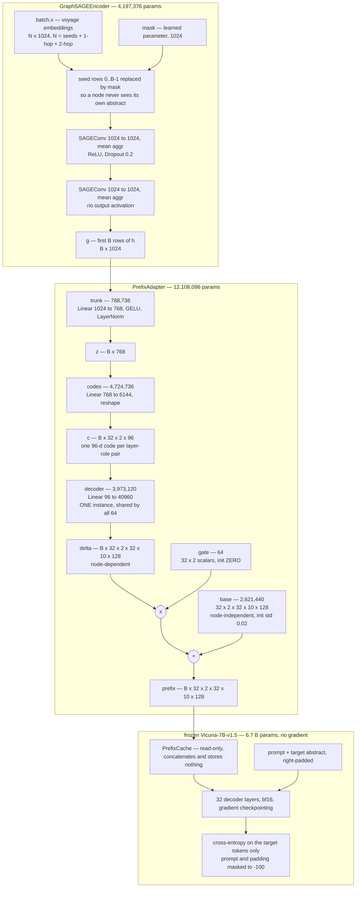

# Adapter — graph-conditioned abstract generation

> **Note — the repository was reorganised on 2026-08-05.** Paths below are as they were when
> each section was written. The code is now under `src/`, datasets under `data/`, results under
> `experiments/`, and job scripts under `hpc/komondor/`. See [`README.md`](../README.md) for the
> current mapping. The reasoning and the numbers are unaffected.

Generate a paper's abstract from its citation neighbourhood. A GNN encodes the neighbourhood,
an adapter maps that encoding to soft prefix tokens, and the prefix is injected into a frozen
Vicuna-7B. The prefix is the only trainable channel into the LLM — there is no LoRA in this phase.

```
neighbourhood → GraphSAGE → adapter → k prefix tokens → frozen Vicuna-7B → abstract
```

**Stages:** 1 data prep · 2 graph tensors · 3 model · 4 training · 5 generation + eval · 6 ablations

Stage 5 onwards is documented in [`adapter_evaluation.md`](adapter_evaluation.md).

---

## Stage 1 — Data prep (`prepare_data.py`)

**Date:** 2026-07-27

### Goal

Fix, once and in writing, which nodes the adapter may train on and which are held out for
evaluation, so that every later stage reads the same sets and no result depends on an
undocumented sampling decision.

### Decisions

**Eligible node = `core == True` and `5 ≤ out_degree ≤ 15`.**
Out-degree counts outgoing edges in `joint_dataset/edges.csv`, where `src` cites `dst` — so
out-edges are the paper's own references. References are chosen over citations because they
exist at publication time; papers *citing* the target are published later, and conditioning on
them would leak the future. The 5–15 band keeps the neighbour text inside Vicuna's 4,096-token
context. `core == True` restricts to the original ogbn-arxiv nodes, which are the only ones
`splits.json` covers.

**Evaluation set = 495 nodes, 45 at each out-degree from 5 to 15**, drawn from the eligible
test nodes with `numpy` seed 42. Equal-sized bins mean quality can be plotted against neighbour
count without bin size confounding the trend. 495 rather than 500 because 500 does not divide
evenly across the 11 degree values, and exactly even bins are worth more than a round total.

### The S2 coverage finding

The eval set was originally going to be the 200 `is_test` nodes of
`ogbn_arxiv_dataset/nodes_subset.csv` (10 nodes at each out-degree 1–20), to stay comparable
with the earlier Vicuna-7B and GPT-5.4-mini runs in `test_data/`. Checking those nodes against
the joint graph showed why that does not work, and turned up a property of the dataset that
affects the whole project:

**ogbn-arxiv records only citations between arXiv CS papers. `joint_dataset` adds Semantic
Scholar bibliographies, which are the papers' real reference lists.** Among the 169,343 core
nodes, 94,756 (56%) have an S2 record and 74,587 (44%) do not:

| | count | mean out-degree |
|---|---|---|
| S2 bibliography present | 94,756 (56%) | 17.0 |
| ogbn-internal citations only | 74,587 (44%) | 6.9 |

Two consequences:

1. **The old 200-node set is unusable.** Stratified over ogbn degree 1–20, those nodes span
   out-degree 1–65 in the joint graph, and about half of them produce prompts that overflow the
   4,096-token context. Comparability with the earlier baselines is given up; all arms will be
   rerun on the new eval set.
2. **Out-degree does not mean the same thing for every node.** For an S2-covered paper it
   approximates the true reference count; for an uncovered one it is only the arXiv-CS slice of
   the bibliography. A low out-degree therefore means either a short bibliography or an unseen
   one — and 37% of the 65,609 eligible nodes are uncovered, so this is not a rare edge case.

Coverage was deliberately **not** made an eligibility criterion; the per-degree breakdown is
printed whenever the set is frozen so the confound stays visible in the results.

### Inputs / outputs

| | |
|---|---|
| In | `joint_dataset/nodes.csv`, `joint_dataset/edges.csv`, `joint_dataset/splits.json` (+ `ogbn_arxiv_dataset/edges.csv`, coverage report only) |
| Out | `adapter/eval_nodes.json` (495 node_ids), `adapter/splits_eligible.json` (eligible node_ids per split) |
| Run | `python adapter/prepare_data.py` |

### Results

Joint dataset: 384,756 nodes, 3,844,151 edges, 169,343 of them `core`.
**65,609 nodes are eligible.** Intersected with the splits:

| Split | Eligible nodes |
|---|---|
| train | 36,093 |
| valid | 12,020 |
| test | 17,496 |

Evaluation set: 495 nodes, 45 per degree. S2 coverage rises with out-degree, from 31% at
degree 5 to 64% at degree 15, 56% overall — the confound described above, now quantified on the
exact set that will be scored.

### Verification

Six assertions run on every invocation and abort the script on failure — all passed:
no duplicate eval nodes; every eval node is `core`, in the test split, and eligible; no eval
node appears in the eligible train or valid sets; and every degree bin has enough candidates
to sample from (the smallest, degree 15, has 1,306 available for 45 slots).

The disjointness of the splits makes the train/valid check structural rather than lucky.

Sampling determinism was checked by hand: seed 42 reproduces a byte-identical
`eval_nodes.json` across runs, seed 7 produces a different one, and returning to 42 restores
the original.

### Limitations and open questions

- **S2 coverage confound**, described above — measured, not removed.
- **Data artifacts in `joint_dataset/edges.csv`**: 20 self-loops, and mutual citation pairs
  (≈1.5% of a 500k-edge sample had their reverse also present). Neither is possible in a strict
  citation DAG. Harmless for message passing, but they weaken a "references only, temporally
  honest" claim and should be settled in Stage 2.
- **Message-passing direction is undecided.** Blocks Stage 2. Raw `edge_index` sends messages
  from citing to cited paper, so a 2-layer GraphSAGE on the unmodified direction would aggregate
  papers that cite the target — reintroducing exactly the temporal leak the out-degree filter
  was chosen to avoid. Out-edges only, reversed, or undirected has to be settled before
  `NeighborLoader` means anything.

### Correction to the original plan

The plan recorded 12,028 valid nodes. The measured count is **12,020**.

---

## Stage 2 — Graph tensors and dataloaders (`graph.py`)

**Date:** 2026-07-27

### Goal

Build the PyG graph the GNN trains on, and the loaders that feed it neighbourhoods.

### Decisions

**The graph is directed: references only.** `edges.csv` stores (citing, cited), and PyG
aggregates along in-edges, so `edge_index` is stored **reversed** as (cited, citing). Messages
flow from a paper's references into the paper, and a node learns only from work it cites.

This matches the situation at generation time: when a new paper's abstract is written, its
reference list exists but nothing has cited it yet. Aggregating incoming citations would feed
the model papers published *after* the target — information that would not be available in real
use. It also makes hop 1 exactly the node's reference list, so the graph agrees with the 5–15
out-degree filter from Stage 1 instead of cutting across it.

**All 1-hop and all 2-hop neighbours** (`num_neighbors=[-1, -1]`), no sampling cap.

**The 20 self-loops are dropped**, and edges are coalesced. A paper citing itself is a data
artifact, and with the seed's features masked in Stage 3 a self-loop would feed the mask vector
into its own aggregation.

**`Data` stays on CPU**; sampling runs there and only the sampled subgraph moves to the GPU.
Resident 1.6 GB features on the GPU would buy nothing for batches touching ~1,400 nodes.

### Why not undirected — a detour worth recording

Undirected edges were implemented first and then reverted. Two problems, both measured:

1. **Temporal leak.** Papers citing the target became 1-hop neighbours despite being published
   later.
2. **A heavy computational tail.** Undirected 1-hop pulled in incoming citations from hub
   papers (max degree 16,513), so full 2-hop neighbourhoods ran to 29,650 nodes at p99 and
   94,721 at worst — roughly 200× variation in batch memory.

An exact workaround was explored for problem 2: because SAGEConv layer 1 is linear in the input
features and those features are frozen, the mean of each node's raw neighbour features can be
precomputed once, letting the exact 2-layer output be computed from 1-hop neighbours alone
(verified to ~1e-6 against the full path). Switching to reference-only edges made it
unnecessary — the tail was an artifact of undirecting, not of the task — and avoids the
constraints it would have imposed (2 layers only, mean/sum aggregation only). Recorded because
the technique would apply again if a much denser graph is ever used.

### Inputs / outputs

| | |
|---|---|
| In | `joint_dataset/node_embeddings.npy`, `joint_dataset/edges.csv`, `adapter/splits_eligible.json`, `adapter/eval_nodes.json` |
| Out | none — a module: `load_graph()` and `make_loader()` are imported by later stages |
| Run | `python adapter/graph.py` builds the graph and prints stats |

### Results

Graph: 384,756 nodes, **3,844,131 directed edges**, features `(384756, 1024)` float32 (1.58 GB).
References per node: mean 10.0, max 832.

Loaders seed from train (36,093), valid (12,020) and the frozen eval set (495).

Neighbourhood size for eligible train seeds, measured over 3,000 samples:

| | mean | median | p99 | max |
|---|---|---|---|---|
| 1-hop (references) | 8.6 | 8 | 15 | 15 |
| 2-hop (references of references) | 50.6 | 36 | 215 | 370 |

Roughly 60 nodes per seed. A batch of 32 produced 1,406 nodes and 1,918 edges — no cap needed
anywhere, and batch size is limited by the LLM in Stage 4, not by the graph.

Hop 2 is genuinely populated: S2-only nodes carry their own references (mean out-degree 8.0),
10% of 1-hop neighbours are dead ends, and only 0.3% of seeds have an empty 2-hop neighbourhood.
This matters for the architecture — the prefix is supposed to carry 2-hop information the
1-hop prompt text does not.

### Verification

Four assertions run on build and abort on failure — all passed:

1. No self-loops survive.
2. No duplicate edges survive.
3. **Seed nodes occupy rows 0..batch_size-1** of each batch — what Stage 3's `[MASK]`
   substitution depends on.
4. **A seed aggregates exactly the papers it cites in `edges.csv`** — the direction check.
   Edge direction is the one thing here that could be silently backwards and still run, so it is
   asserted against the raw file rather than assumed.

### Limitations and open questions

- **10% of 1-hop neighbours have no references of their own**, contributing nothing at hop 2.
- **Local environment.** `NeighborLoader` needs `pyg-lib` or `torch-sparse`; neither ships a
  macOS ARM wheel, so `torch-sparse` and `torch-scatter` were built from source into the
  `DyTAG` conda env. The Komondor container needs the same dependency.
- **Row alignment of `node_embeddings.npy` is assumed, not re-verified here.** `embed_nodes.ipynb`
  asserts `node_id == row index` at write time. Re-embedding a node through Voyage would confirm
  it end-to-end, but the `VOYAGE_API_KEY` in `.env` is currently rejected as invalid.

---

## Stage 3a — GraphSAGE encoder (`model.py`)

**Date:** 2026-07-27

### Goal

Encode a target node's reference neighbourhood into a single vector. This is the encoder only —
the adapter that turns this vector into soft prefix tokens is a separate piece, still to come.

### Decisions

**Two SAGEConv layers, 1024 → 1024 → 1024, mean aggregation.** Constant width keeps the
representation as wide as the input; input dim is fixed at 1024 by the voyage embeddings. Layer 1
sees the node's references, layer 2 the references of those references — matching the design
where prompt text carries 1-hop and the prefix carries 2-hop.

**A learned `[MASK]` vector replaces the seed's own features.** The seed's embedding is the
voyage encoding of the very abstract being generated, so leaving it visible would let the model
copy the answer. A trainable parameter shared across seeds lets the model learn a representation
meaning "this node is the unknown target", which zeros could not express. Initialised to unit
norm to match the L2-normalised voyage features it stands in for.

**Mean aggregation** (PyG's `SAGEConv` default). It suits this data unusually well: the features
are unit-norm semantic embeddings, so the mean of a node's ~9 references is a genuine centroid
of what those papers are about, and it is invariant to set size, which matters when degree
varies 5–15. `sum` was rejected because it entangles reference count with content — output norm
would vary 3× across the degree band, feeding an adapter that has to emit prefix vectors at a
stable scale. The order-dependent aggregators (`lstm`, `gru`, `sort`) were rejected because
references have no canonical order.

**Dropout 0.2** between the layers — lighter than the 0.5 in
`GraphSAGE_classification/train_graphsage_full.py`, because the GNN is small relative to 36,093
training nodes and heavy dropout on a ~9-neighbour aggregation is a large perturbation.

**No activation on the output layer.** A final ReLU would force the vector handed to the adapter
to be non-negative, discarding half the representational space for no benefit.

### Inputs / outputs

| | |
|---|---|
| In | batches from `graph.py` (`batch.x`, `batch.edge_index`, `batch.batch_size`) |
| Out | none — a module: `GraphSAGEEncoder` returns `(batch_size, 1024)`, one embedding per seed |
| Run | `python adapter/model.py` runs a forward pass on one batch |

### Results

**4,197,376 trainable parameters.** A batch of 8 seeds (362 nodes, 504 edges) produced a
`(8, 1024)` output with vector norms in 0.774–0.802.

### Verification

Two assertions, both passed:

1. Output shape is `(batch_size, 1024)`.
2. **Randomising the seed rows of `batch.x` leaves the output bit-identical** — proof that the
   mask is actually applied and the target's own embedding cannot reach the result. This is the
   failure that would be most damaging and least visible: without it the model could copy the
   answer and every metric would look excellent.

### Limitations and open questions

- **Masking depends on seeds occupying rows 0..batch_size-1**, which `graph.py` asserts. If the
  loader is ever changed, that assertion is what protects this.
- **The mask is one shared vector**, so every seed's layer-1 root term is identical; a seed's
  representation comes entirely from its neighbourhood. That is intended, but it means the model
  cannot condition on anything about the target itself, not even its year or venue.
- **Uniform averaging weights irrelevant references equally.** The `cosine_filter` work labelled
  2,100 edges with GPT and found 845 relevant vs 1,255 *not* directly relevant — so roughly 60%
  of references may be noise that mean aggregation treats the same as the rest. Measured on the
  old ogbn-internal subset, so indicative rather than exact. This is the concrete motivation for
  the attentional-aggregation ablation, and it connects to the neighbourhood-filter extension in
  the project plan.
- **Aggregation is a one-line ablation** for Stage 6: `AttentionalAggregation` (learned weight per
  reference, motivated above) and `aggr=['mean','max']` are the two candidates worth measuring
  against the mean baseline.

---

## Stage 3a addendum — what the `[MASK]` vector is, and seed–seed collisions

**Date:** 2026-07-28

### What the mask is, and what it is not

It is an **input-side placeholder**, not an initialisation or prior for the target's embedding.
The model never predicts an embedding of the abstract being generated: there is no reconstruction
loss, the encoder output is a *neighbourhood* encoding, and the abstract itself is produced
downstream by the LLM. There is no "target embedding" for the mask to initialise.

Its job follows from the `SAGEConv` update, which is a root term plus a neighbour term:

> h_i = W_root · x_i + W_neigh · mean_{j ∈ N(i)} x_j

For a seed, `x_i` *is* the voyage embedding of the abstract being generated, so `W_root` would hand
the model the answer directly. Replacing that row removes the path. Layer 2 is deliberately **not**
re-masked: `h_seed` from layer 1 is already free of the target's features, so `conv2`'s root term is
both safe and — unlike layer 1's — genuinely informative, since it carries the 1-hop aggregate.

### What it learns

Because one vector is shared across all seeds, its whole contribution to layer 1 is the constant
`W_root · mask`, identical for every seed in every batch. **It cannot carry node-specific
information.** Its function is to be a learned "this row is the unknown target" flag — the only
thing distinguishing a seed row from an ordinary node row at layer 1 — and to place the seed's
pre-activation in a useful region of the ReLU. Zeros could not do this: they leave only `conv1`'s
bias, which applies identically to every row. The upside is real but bounded; expect a small
effect, not a representational one.

### Masking is batch-local

`model.py` slices on `batch.batch_size`, which is the number of seeds **in the current batch**, not
in the split. A train seed sitting in some other batch appears here as an ordinary sampled
neighbour with its features intact.

`NeighborLoader` deduplicates node rows, so when a seed is also a neighbour of another seed *in the
same batch*, both share one row — the seed row — and the neighbour therefore aggregates the mask
instead of that paper's real embedding. Verified on a 6-node synthetic graph where node 1 is a
reference of node 0 and both are seeds: at `batch_size=2` node 1 lands at row 1 and is masked; at
`batch_size=1`, same node and same row, it falls outside the seed range and keeps its real feature.

Collision rate over 400 shuffled batches of eligible train seeds, counting 1-hop and 2-hop:

| batch size | batches with a collision | seed appearances affected |
|---|---|---|
| 8 | 1.2% | 0.19% |
| 32 | 19.2% | 0.79% |
| 64 | 60.5% | 1.79% |

### Both consequences of masking by row position

**The cost.** A seed loses one real reference to a constant vector, and the forward pass becomes
dependent on batch composition. This is a pure loss with no compensating benefit — a paper cited by
the target genuinely exists when the target is written, so its features are legitimate signal. It
errs in the safe direction, though: information is removed, never added, so it cannot leak. Note
the mask is a *constant*, not noise, so the effect is a slight fixed bias in the centroid rather
than added gradient variance. At `batch_size=32` it touches 0.79% of seed appearances per epoch,
well inside the noise floor of `DROPOUT = 0.2`.

**The benefit.** It closes the self-leak path opened by the mutual citation pairs recorded in
Stage 1 (≈1.5% of a 500k-edge sample). If A cites B and B cites A, then A sits at its own 2-hop;
row-based masking means B aggregates the mask rather than `x_A`, so the target's own embedding
still cannot reach it. Masking by "hop-0 node" instead of by row would have left that open.

**Decision: not fixed.** The cheap alternative — masking by node id rather than row position —
would trade a sub-1% input loss for reopening the mutual-citation leak, which is the more damaging
of the two. Recorded rather than engineered around.

### Limitations

- **The cost scales with batch size** — 60.5% of batches at 64. If Stage 4's LLM memory budget
  forces larger graph batches, this needs re-measuring.
- **The `model.py` smoke test cannot catch this.** It randomises seed rows and asserts the output
  is unchanged; a collision only makes that invariant hold *harder*.
- **Collision rates are measured on the train split** with one shuffle seed, as an order of
  magnitude rather than an exact figure.

---

## Stage 3b — the prefix adapter

**Date:** 2026-07-30

### Goal

Turn the encoder's 1024-d neighbourhood vector into the key/value prefixes injected into every
layer of a frozen Vicuna-7B-v1.5. Prefix tuning was chosen over input-only soft tokens so the graph
signal enters at all 32 layers rather than having to survive propagation from the embedding layer.

### Why a naive adapter is impossible

Vicuna-7B is Llama-2-7b: 32 layers, 32 attention heads, `head_dim` 128, **no GQA**, so keys and
values are each a full 4096 per token per layer. At 10 prefix tokens:

| | |
|---|---|
| numbers per (layer, role) | 10 x 4096 = 40,960 |
| (layer, role) pairs | 32 x 2 = 64 |
| total prefix numbers per node | 2,621,440 |
| naive: 64 independent `Linear(1024 -> 40960)` | **2.68 B parameters** |

The cost is in the **output**, not the input: any linear map ending in 2.6M numbers costs
`bottleneck x 2.6M`, so shrinking the 1024-d input alone saves nothing. Even a single shared
`Linear(1024 -> 40960)` is 42M, and a bottleneck of 8 still costs 21M.

### Design

Three factorisation axes, of which the layer axis does the real work:

```
g (1024)
 -> trunk    Linear(1024->768) -> GELU -> LayerNorm        z (768)
 -> codes    Linear(768 -> 32*2*96), reshape               c[layer, role] (96)   x64
 -> decoder  Linear(96 -> 10*4096)  SHARED across all 64   delta[layer, role]

prefix[layer, role] = base[layer, role] + gate[layer, role] * delta[layer, role]
```

Giving each of the 64 heads a small code and expanding it with **one shared decoder** replaces
`64 x (768 x 40960)` with `64 x (768 x 96)` plus a single `96 x 40960`.

`base` is a node-independent learned prefix — classic prefix tuning, carrying the task format the
graph should not have to re-derive 64 times. `gate` is one scalar per (layer, role), **initialised
to zero**, so training starts as plain prefix tuning with the graph disconnected.

Output shape is `(batch, 32, 2, 32, 10, 128)`, keys at index 0 of dim 2. Stage 4 converts it to
`past_key_values`; `model.py` deliberately does not import transformers.

### Parameters

| block | params |
|---|---|
| trunk | 788,736 |
| codes | 4,724,736 |
| decoder (shared) | 3,973,120 |
| base | 2,621,440 |
| gate | 64 |
| **adapter** | **12,108,096** |
| GraphSAGE encoder | 4,197,376 |
| **trainable total** | **16,305,472** |

221x smaller than the naive design, against 36,093 training nodes.

### Decisions and their reasoning

- **`trunk_dim` 768, `code_dim` 96.** Chosen to lose less of the 1024-d input than the 512/64
  variant first considered, which came to 7.9M. Each layer reads the graph through only a 96-d
  projection, but 64 x 96 = 6144 code dimensions across all layers, comfortably above 1024 — so
  *collectively* the layers can read the whole encoder output, and nothing is lost globally.
- **One decoder shared by all 64 heads**, rather than per-layer or per-group decoders. Per-layer
  decoders would cost 64 x 3.97M = 254M. Layer specialisation has to come through the code and the
  base instead.
- **One `codes` matrix for all heads** rather than a layer embedding fed to a shared MLP. The
  embedding version costs ~37k instead of 4.7M, but the single matmul is simpler; noted as the
  obvious place to cut if capacity turns out to be the problem.
- **`base` initialised at std 0.02**, Llama's own `initializer_range`. These vectors live in
  post-RoPE key space, which has no natural scale to match, so the model's own init constant is the
  least arbitrary choice available.
- **Zero-init gate.** At step 0 the graph cannot affect generation at all, so training starts from
  a stable known regime; and the main ablation ("is the graph doing anything, or is the LLM
  paraphrasing the 1-hop abstracts already in the prompt?") becomes `gate = 0` on the *same*
  weights, not a separately trained model.
- **10 prefix tokens.** Not a capacity constraint: `g` has 1024 dimensions, so every prefix the
  adapter can emit lies on a <=1024-dim manifold regardless of token count, and 40,960 slots per
  layer is already 40x over-provisioned. What the token count buys is the number of distinct
  positions attention can point at.

### Verification

`python adapter/model.py` runs a real 8-seed batch end to end and asserts: output shape; that at
`gate=0` two different graph vectors give a bit-identical prefix equal to `base`; that opening the
gate changes it; and that gradients reach every parameter of both modules. All pass.

### Open questions and limitations

- **The `past_key_values` mechanics are unverified.** `transformers==4.39.3` sits mid-transition
  between the legacy tuple-of-tuples cache and `DynamicCache`, and `generate()` deriving
  `cache_position` from a pre-populated cache is the classic place `position_ids` end up offset by
  `prefix_len`. This is Stage 4's first job and must be tested, not assumed.
- **The prefix is position-free.** HF Llama caches already-rotated keys, so an injected prefix
  bypasses RoPE entirely. Standard for prefix tuning, and harmless since the vectors are learned in
  that space — but it means the 10 tokens have no order.
- **`gate=0` is prefix tuning, not a true no-op.** With `base` near zero the values contribute
  almost nothing, but the 10 prefix positions still absorb some attention mass, slightly diluting
  the real tokens. The ablation is honest as "graph off", not as "prefix absent".
- **PEFT cannot be used.** `PrefixTuningConfig` builds its prefix from an unconditioned embedding
  table, so the cache has to be constructed by hand.
- **No regularisation in the adapter.** The encoder has `DROPOUT = 0.2`; the adapter has none.
  Untested whether 12.1M adapter params overfit 36,093 nodes.
- **Whether per-layer conditioning earns its keep is unmeasured.** The 2.6M-number output exists
  only because the graph enters at all 32 layers. Zeroing gates for layers 1-31 tests this cheaply
  and should be run before the design is defended.

---

## Housekeeping — `adapter/config.py`

**Date:** 2026-07-30

Every module-level constant in `prepare_data.py`, `graph.py` and `model.py` now lives in
`adapter/config.py`, grouped by stage. The scripts import what they need; no constant is defined in
two places any more (`SCRIPT_DIR` and `ROOT` had been duplicated across all three).

What did **not** move: values already exposed on the command line — input paths, `--batch-size`,
the `--seed 42` used to freeze the eval set — stay as argparse defaults in the script that owns
them, since they have a working home already and moving them would mean routing CLI defaults
through an import for no gain.

Verified by re-running all three scripts. `prepare_data.py` was run with `--out-dir` pointing at a
scratch directory and its two JSON outputs diffed byte-for-byte against the committed ones
(identical, so the frozen eval set has not moved). `graph.py` and `model.py` pass every assertion,
with parameter counts unchanged at 4,197,376 and 12,108,096.

Note the folder uses flat imports (`from config import ...`, `from graph import ...`), which assume
the scripts are run from inside `adapter/` or with it on `sys.path`. That was already true of
`model.py` importing `graph`; `config.py` follows the same convention rather than introducing a
package. If Stage 4 wants `from adapter.model import ...`, this needs an `__init__.py` and relative
imports throughout.

---

## Stage 4, step 1 — verifying prefix injection (`verify_prefix_injection.ipynb`)

**Date:** 2026-08-01

### Goal

Establish that a hand-built KV cache is treated by `transformers==4.39.3` exactly like real
tokens, before any training code is written. Stage 3b listed the `past_key_values` mechanics as
unverified; everything downstream rests on them, and the failure mode is **silent** — a wrong mask
or offset produces plausible logits and a decreasing loss, not an exception. A model trained
against a misread prefix would be unfalsifiable after the fact.

### Method, and why it is trustworthy

Every check compares **two runs of the same model**, so the weights are irrelevant and a 4-layer
random Llama exercises the same `forward`, `_update_causal_mask`, RoPE and `DynamicCache.update` as
Vicuna-7B. The notebook therefore runs on a laptop CPU in seconds. The local `DyTAG` env has
`transformers==4.39.3`, the same version the Komondor container pins, and the notebook asserts this.

The ground truth is text: split a token sequence into `prefix ++ body`, then compare a plain
forward over the whole sequence against a forward over `body` with the *real* key/values of
`prefix` injected. A zero prefix would prove nothing — a broken mask would still give plausible
numbers — so the injected cache has to be one whose correct effect is already known.

### Results

Injection works, but only under a specific recipe. Agreement with the plain forward pass is
**3.3e-07**, and greedy generation matches token-for-token.

| | requirement | what happens otherwise |
|---|---|---|
| cache type | `DynamicCache`, built via `.update()` | a legacy tuple raises `AttributeError` under `use_cache=False` |
| `attention_mask` | length `P + L` | a length-`L` mask raises; omitting it is correct only for unpadded batches |
| `cache_position` | pass `arange(P, P+L)` explicitly when `use_cache=False` | **max logit error 0.74, silently** |
| `position_ids` | free choice — but train and generate must agree | prefix read at an offset it was not trained for |
| cache lifetime | rebuild every step | a forward pass appends the body's keys: length 10 → 26 |
| `generate()` | override `prepare_inputs_for_generation` | different tokens; passing `cache_position` to `generate()` is ignored |

Gradients reach every adapter parameter through the frozen LLM, and **zero** LLM parameters carry a
gradient — `DynamicCache.update` uses `torch.cat`, which keeps the graph connected.

### The two findings that change Stage 4

**1. `cache_position`, not `position_ids`, is the real hazard.** `LlamaModel.forward` computes
`past_seen_tokens` from the cache *only inside* `if use_cache:`. With `use_cache=False` it stays 0,
so `cache_position` defaults to `arange(0, L)` while the key axis is `P + L` long — and
`cache_position` is what sizes the causal mask. Every row shifts by `P`, so each token attends
mostly to prefix positions instead of to the tokens before it. This matters because
`use_cache=True` is **incompatible with gradient checkpointing**, which `LlamaModel.forward`
silently turns off — i.e. the corruption appears exactly in the configuration training runs in.

**2. `generate()` cannot be used unmodified.** Every search method in `generation/utils.py` begins
with `model_kwargs["cache_position"] = torch.arange(cur_len)`, where `cur_len` is the length of
`input_ids` alone. It **overwrites** any `cache_position` passed in and ignores the pre-filled
cache, so generation hits the same corruption on every step and cannot be fixed by argument.
Overriding `prepare_inputs_for_generation` — the last thing to touch `cache_position` before the
forward pass — repairs every step including incremental decoding; the override must name its
catch-all `**kwargs`, because `_validate_model_kwargs` inspects the signature by name.

### Correction to Stage 3b

Stage 3b recorded the `position_ids` offset as the expected failure ("the classic place
`position_ids` end up offset by `prefix_len`"). **That was wrong.** Llama's RoPE is relative, so
shifting every real token by the same `P` leaves token-to-token attention unchanged — measured at
3.6e-07 against a run with no cache. The offset only changes how queries see the *prefix*, whose
keys are position-free (0.041 max logit difference between the two conventions). It is a design
choice to be applied consistently, not a correctness bug.

### Inputs / outputs

| | |
|---|---|
| In | `adapter/config.py`, `adapter/model.py` (`PrefixAdapter`) — no data, no checkpoint |
| Out | none — a verification artefact. `prefix_to_cache()` and the `prepare_inputs_for_generation` override are the code Stage 4 lifts from it |
| Run | open in Jupyter with the `DyTAG` env, from inside `adapter/` (flat imports); ~10 s on CPU |

### Limitations

- **Random weights, tiny dimensions.** Verifies the code path, not the real checkpoint. Whether
  Vicuna-7B loads, and whether bf16 or 8-bit numerics behave, is the first Komondor run's job.
- **Batch size 1, no padding.** Padded batches need a real `P + L` mask; that combination is
  untested here.
- **Gradient checkpointing itself is not exercised** — the notebook infers the `use_cache=False`
  requirement from it, and tests that setting directly, but never enables checkpointing.
- **`sdpa` attention only** (the CPU default). The GPU run may select a different implementation.

---

## Stage 4 — training the adapter (`text.py`, `train.py`)

**Date:** 2026-08-01

### Goal

Train the GraphSAGE encoder and prefix adapter against a frozen Vicuna-7B, so that the graph
neighbourhood conditions the generated abstract. 16.3M trainable parameters; the LLM never
receives a gradient.

### Task framing

The prompt contains the **1-hop reference titles and abstracts and nothing about the target** —
not even its title. The model must infer the topic from the neighbourhood alone, which is both
the hardest version of the task and the one that leaves the most room for the graph prefix to
matter. The Vicuna-v1.1 chat format is carried over verbatim from `scripts/generate_test_csv.py`,
so results stay comparable with the earlier Vicuna and GPT-5.4-mini baselines in `test_data/`.
Loss is cross-entropy on the target abstract's tokens only; the prompt is masked with `-100`.

### The training sets

| set | size | how |
|---|---|---|
| train | 4,000 | seeded sample of eligible train nodes whose sequence fits the context |
| valid | 495 | 45 at each out-degree 5–15, mirroring the eval set's construction |
| test | 495 | unchanged — the frozen `eval_nodes.json` |

Nodes whose prompt + target + 10 prefix tokens exceed 4,096 are **dropped**, so every training
sequence is complete. The alternative — truncating neighbour text — would have given
high-degree nodes systematically less text per reference, which is a worse confound than a mild
shift in the degree distribution. Candidates are shuffled and walked until enough survivors are
found, which matches sampling from the fitting set but tokenises a few thousand nodes rather
than all 48,000.

Validation is 495 rather than a round 500 because 500 does not divide across 11 degrees, and
equal bins are worth more than a round total — the same reasoning that fixed the eval set at 495.

### The training recipe

Each part of this fails **silently** if dropped; all of it comes from
`verify_prefix_injection.ipynb`:

- `PrefixCache` — a read-only cache that concatenates the prefix and stores nothing. A
  `DynamicCache` cannot be used: gradient checkpointing recomputes every layer, and a mutating
  cache appends the body's keys a second time (10 → 26 → 42 positions).
- `attention_mask` of length `10 + L`, covering the prefix.
- explicit `cache_position = arange(10, 10 + L)`, because `use_cache=False` leaves
  `past_seen_tokens` at 0 and the causal mask is then built as if the prefix were absent.
- `use_reentrant=False`, because with a frozen LLM no tensor input to layer 0 requires a
  gradient and reentrant checkpointing refuses to build a graph.

Positions run `10 .. 10+L-1` (the default, `position_ids = cache_position`) — the same
convention the patched `generate()` produces. Train and generate must agree, or the prefix is
read at an offset it was never trained for.

**Hyperparameters:** AdamW, lr 1e-4, 100-step linear warmup then constant, weight decay 0
(decaying `base`/`gate` would pull the prefix toward the ablation), grad clip 1.0, batch 4 with
gradient accumulation 4 → effective 16. Batch 4 also keeps the seed-collision rate from the
Stage 3a addendum near 0.2%.

**The gate is left to learn freely** from zero — no warmup, no forced opening. If it stays near
zero, that is a real result about the graph rather than an artefact of the schedule. Validation
therefore reports the loss twice, with the learned gate and with the gate forced to zero: the
"graph off" ablation on identical weights, measured every evaluation instead of in a separate run.

### Budget on one A100 40 GB

| | bf16, no checkpointing | bf16 + checkpointing |
|---|---|---|
| frozen weights | 13.5 GB | 13.5 GB |
| activations, batch 1 @ 2,500 tok | ~14 GB | ~0.7 GB |
| same @ 3,800 tok (p90) | ~22 GB | ~1.0 GB |
| **peak, batch 1** | **28–36 GB** | **~15 GB** |

Checkpointing costs one extra forward (~4 forward-equivalents, ~5.4e10 FLOPs/token), giving an
estimated **~1.1 s per 2,500-token sequence** at ~40% MFU — about **1.2 h per epoch** over 4,000
nodes, so two epochs fit one 6 h job. A full 36,093-node epoch would be ~11 h and needs the
resume path.

### Verification

The real model cannot run locally, so every check uses a 4-layer random Llama with the **real
Llama tokenizer** (same 32,000 vocab, BOS 1, EOS 2) and a synthetic graph, through the actual
functions in `train.py` and `text.py`.

| check | result |
|---|---|
| full `main()`: 2 epochs, validation, checkpoint, resume | runs; resume restores epoch and step |
| gradient checkpointing genuinely active | `llm.model.gradient_checkpointing == True` |
| padding is neutral (22- vs 62-token prompts, 40 tokens of padding) | batched loss vs token-weighted singles differ by **2.4e-04** |
| the prefix can learn (overfit one batch, 30 steps) | **10.26 → 7.95** |
| labels aligned, target abstract and title absent from the prompt | asserted |
| `fits()` boundary | rejects at 4,087 tokens, accepts 4,086 |

### Deviations from the plan

- **`PrefixCache` lives in `train.py`, not `model.py`.** It is training-only — generation uses a
  pre-filled `DynamicCache` — and keeping it out preserves the documented property that
  `model.py` does not import `transformers`.
- **Validation is 495, not 500**, for the equal-bins reason above.

### Inputs / outputs

| | |
|---|---|
| In | `joint_dataset/nodes.csv`, `edges.csv`, `node_embeddings.npy`, `adapter/splits_eligible.json` |
| Out | `adapter/training_sets.json` (frozen train/valid ids), `adapter/checkpoints/epoch*.pt` (encoder + adapter + optimizer, ~196 MB — never the LLM) |
| Run | `python adapter/text.py` once, then `python adapter/train.py --epochs 2 --batch-size 4` |

### Blockers before the first GPU run

- **The container has no PyG.** `Komondor_files/baseline-gpu.def` installs transformers, peft,
  accelerate and bitsandbytes but not `torch_geometric`, and `NeighborLoader` needs it plus
  `pyg-lib`/`torch-sparse`. Linux wheels exist for torch 2.2 + cu121, so this is a container
  rebuild, not the source build the macOS environment needed.
- **`text.py` cannot run locally.** Vicuna's tokenizer ships only as a sentencepiece model with
  no `tokenizer.json`, and `sentencepiece` is not in the local `DyTAG` env (it *is* in the
  container). Run `text.py` on Komondor, or install sentencepiece locally.

### Limitations

- **Nothing has run on a real GPU or the real checkpoint.** Memory and throughput are estimates;
  bf16 numerics, the actual attention implementation and OOM behaviour on p99-length sequences
  are unverified.
- **Tokenisation happens per batch**, repeated every epoch. Negligible against ~1.1 s of GPU
  time per sequence, but it is wasted work.
- **No early stopping and no LR decay** — constant LR after warmup, fixed epoch count.
- **The 4,000-node subset is a first run, not a final model.** Its purpose is to answer whether
  the loss moves and whether the gate lifts.

---

## Stage 4b — metric tracking with Weights & Biases (`train.py`)

### Goal

Komondor jobs are batch jobs: without live metrics the only feedback is a log file read after
the fact, and a run that has stopped learning burns its whole 6 h allocation before anyone
notices. W&B also makes runs comparable across the ablations planned for Stage 6, which is what
the thesis actually needs from them.

### What is logged

Opt-in via `--wandb` (default off), so CPU smoke tests and debug runs stay dependency-free.
`--wandb-project` (default `dytag-adapter`) and `--wandb-run` name the run.

| series | why it is there |
|---|---|
| `train/loss`, `train/lr`, `train/tokens_per_sec`, `train/epoch` | the basics; tok/s also confirms the A100 estimate of ~1.1 s per 2,500-token sequence |
| `train/grad_norm` | the pre-clip norm returned by `clip_grad_norm_`. Free, and says whether `GRAD_CLIP = 1.0` is binding or inert |
| `valid/graph`, `valid/gate0`, `valid/delta` | the graph-vs-no-graph ablation, already computed by `validate()` on identical weights. `delta` is the central claim of the thesis, watched during training rather than discovered at the end |
| `gate/mean_abs`, `gate/max_abs`, `gate/per_layer` (histogram) | the gate is the switch that lets the graph in. The histogram over the 32×2 entries shows *where* in the stack the graph gets used — a figure on its own |
| `prefix/graph_fraction` | mean ‖prefix − base‖ / ‖base‖ over the batch: the share of the prefix the graph supplies, rather than the node-independent part |

`graph_fraction` is a new helper in `train.py`. Because `gate` starts at zero, `prefix - base` is
exactly the graph's contribution, and the metric is 0 at initialisation by construction.

`step_loss` now returns `(loss, prefix)` rather than just the loss, so the prefix statistics come
from the forward pass that was already run instead of a second one. The value logged is a
snapshot from the last micro-batch of the accumulation window, not an average over it.

### Verification

Real W&B is not installed locally, so the code path was exercised against a stub module that
records every call, through the actual `main()`.

| check | result |
|---|---|
| `init` receives project, run name and config | 21 config keys, including all hyperparameters and `trainable_parameters` |
| all twelve series reach `log` | asserted by name |
| histogram construction | 4 built over 4 logging steps |
| `step` is monotonic across train and validation logs | asserted |
| `finish()` called exactly once | yes |
| `summary` carries the final numbers | `final/graph`, `final/gate0`, `final/delta` |
| `--wandb` absent | full run + resume complete with no wandb import |
| `graph_fraction` at `gate = 0` vs open gate | `0.000000` vs positive |

Observed on the tiny smoke model: with `gate` forced to 1.0, `graph_fraction` reaches ~130 — the
un-gated `delta` is far larger than `base` (std 0.02), so the gate only has to reach ~0.01 for the
graph to contribute on the same scale as the node-independent prefix. Expect the useful range of
`gate/mean_abs` to be small; that is not a sign the gate is stuck.

### Known limitations

- **No offline mode.** Training runs on internet-connected nodes, so `wandb` writes online; a
  node without egress would need `WANDB_MODE=offline` plus a later `wandb sync`.
- **Resume starts a new W&B run** rather than continuing the old one (`wandb.init(resume=...)`
  is not wired up). Step numbers stay monotonic, so the curves concatenate correctly, but they
  land in two runs.
- **Checkpoints are not uploaded as artifacts.** They stay on the filesystem.
- **`wandb` is in neither the local env nor the container** — see below.

---

## Stage 4c — the frozen subsets, measured (`training_sets.json`)

`text.py` ran locally on 2026-08-02 with the real `lmsys/vicuna-7b-v1.5` tokenizer. The only
thing that had blocked it was a missing `sentencepiece` in the local `DyTAG` env — one wheel,
no dependencies. `protobuf` was already present (as `google.protobuf`), so it was never a
second blocker. Komondor is no longer needed for this step.

`adapter/training_sets.json`: **4,000 train + 495 valid** node ids, no duplicates, no overlap
with each other or with the frozen 495-node eval set (asserted).

### Sequence lengths, in real Vicuna tokens

| set | mean | median | p99 | max |
|---|---|---|---|---|
| train (4,000) | 2,323 | 2,226 | 4,023 | 4,082 |
| valid (495) | 2,757 | 2,789 | 4,055 | 4,083 |

The A100 budget in Stage 4 assumed ~2,500 tokens per sequence; the measured train mean is
2,323, so the ~1.2 h/epoch estimate stands. Validation is ~19% longer than train, because it is
degree-stratified and length rises steeply with out-degree.

### Context overflow is concentrated at high out-degree

Training nodes: **5.9% overflowed** (4,000 kept from 4,253 examined). But the validation
collection, which draws a fixed 45 per degree, exposes where those losses sit:

| out-degree | examined for 45 | overflow | mean tokens |
|---|---|---|---|
| 5 | 45 | 0% | 1,590 |
| 10 | 46 | 2% | 2,850 |
| 13 | 53 | 15% | 3,390 |
| 14 | 62 | 27% | 3,576 |
| 15 | 108 | 58% | 3,650 |

At out-degree 15 more than half of all candidates do not fit 4,096 tokens. This matters for
interpretation: **the dropped nodes are not a random sample.** Within any given out-degree, the
nodes that survive are those with shorter abstracts among their references, so the training set
is biased toward terser neighbourhoods at the high-degree end — precisely the end where the
graph has the most to say. The 5.9% figure understates this because the eligible train split is
dominated by low degrees, where nothing is lost.

The frozen **eval set overflows at 13.1% (65/495)** — higher than train, since it is
degree-stratified. It is deliberately left unfiltered; Stage 5 has to decide whether to
truncate those 65 or report them separately, and either choice needs stating in the results.

### Open question

Whether to raise the effective budget for high-degree nodes — truncating each neighbour's
abstract rather than dropping the node — is unresolved. It would remove the sampling bias but
changes what the model reads, so it is a Stage 5/6 decision, not a silent fix here.

---

## Stage 4d — a separate container (`Komondor_files/adapter-gpu.def`)

### Why a new container rather than extending `baseline-gpu.def`

The first attempt added PyG and wandb to `baseline-gpu.def`. That was reverted. `baseline-gpu.sif`
is what produced the Vicuna baseline in `test_data/`, and `run_generate.sh` depends on it;
rebuilding it in place puts those results behind a container that no longer exists. A second
`.sif` costs disk and nothing else, and the two experiments stay independently reproducible.

`adapter-gpu.def` therefore stands alone rather than inheriting: same proven base image
(`pytorch/pytorch:2.2.0-cuda12.1-cudnn8-runtime`), its own package list.

### Contents

| package | why |
|---|---|
| `transformers==4.39.3` | pinned exactly — the `past_key_values` injection depends on this version's cache internals (`DynamicCache`, `cache_position`, `_update_causal_mask`) |
| `torch_geometric==2.8.0` | `Data`, `NeighborLoader`, `SAGEConv`, `coalesce`, `remove_self_loops` |
| `torch_sparse==0.6.18+pt22cu121`, `torch_scatter==2.1.2+pt22cu121` | `NeighborLoader` refuses to sample without a backend |
| `sentencepiece`, `protobuf` | the Vicuna tokenizer is a sentencepiece model |
| `pandas` | `Corpus` reads `nodes.csv` / `edges.csv` |
| `wandb==0.28.0` | `--wandb`; same pin already proven on Komondor in `graphsage-gpu.def` |
| `accelerate`, `peft` | **not used by `train.py`** — carried so the LoRA stage does not force another rebuild |

`bitsandbytes` was dropped: the adapter trains in bf16, and 8-bit quantisation belongs to the
baseline generation container.

**PyG 2.8.0, not the 2.5.3 in `graphsage-gpu.def`.** 2.5.3 is known to build on Komondor, but
2.8.0 is the version every local verification ran against. The API surface used is five symbols
wide, so matching the verified environment was worth more than matching the older build.

**torch-sparse, not pyg-lib.** Both satisfy `NeighborLoader`; the local environment uses
torch-sparse, so this avoids introducing a sampler nothing has tested. pyg-lib is the faster
backend and is worth revisiting if CPU-side sampling bounds throughput.

**The `+pt22cu121` local versions are pinned in full.** A bare `==2.1.2` lets pip fall back to the
PyPI sdist and start a source compile inside the build; the full pin fails immediately instead.
Wheels for these versions exist on the PyG index for cp38 through cp312, so the pin resolves
whatever Python the base image ships.

A `%test` section asserts a sampler backend is present, numpy is still 1.x, and transformers is
exactly 4.39.3 — so a container that cannot run the pipeline fails at build time rather than in a
queued job.

### Building

Lustre cannot host a fakeroot build, so the image is built on node-local `/tmp` and copied to
`/project` afterwards.

```bash
module load singularity
cd /project/c_gnn42/csanad_thesis/baseline

singularity build --fakeroot /tmp/adapter-gpu.sif Komondor_files/adapter-gpu.def
cp /tmp/adapter-gpu.sif adapter-gpu.sif
rm /tmp/adapter-gpu.sif
```

Run this on a **login node** — `%post` installs from PyPI and compute nodes have no internet.
The `.def` may live on `/project`; only the build *output* has to be local.

No `SINGULARITY_TMPDIR` or `SINGULARITY_CACHEDIR` overrides are needed. The build sandbox already
defaults to `/tmp`, and the existing `baseline-gpu.sif` and `graphsage-gpu.sif` were built from
this same base image with the default `$HOME` layer cache. If a build ever does fail with "no
space left on device", that cache is the cause and `singularity cache clean` clears it.

Checking the copy, since `cp` off `/tmp` is where a truncated image would show up:

```bash
singularity exec adapter-gpu.sif python -c "import torch_geometric.typing as t; print(t.WITH_TORCH_SPARSE)"

srun --account=c_gnn42 --partition=ai --gres=gpu:1 --time=00:10:00 \
     singularity exec --nv adapter-gpu.sif python -c "import torch; print(torch.cuda.is_available())"
```

### Not verified

**This container has not been built.** macOS has no Singularity, so the only checks performed
were that every pinned wheel exists on the PyG index (confirmed for cp38–cp312) and that the
version constraints are mutually satisfiable on paper. `%test` runs automatically at the end of
`singularity build` and is the first real check; `--notest` skips it.

---

## Stage 4e — the training job (`Komondor_files/run_train_adapter.sh`)

Modelled on `run_generate.sh`: same account, partition, GPU request, `$BASE_DIR:/app` bind, and
the same offline HuggingFace environment (`HF_HOME=/app/.hf_cache`, `HF_HUB_OFFLINE=1`), since
compute nodes cannot download the Vicuna checkpoint.

```
--epochs 2 --batch-size 4 --grad-accum 4 --log-every 10 --eval-every 100 --wandb
```

4,000 train nodes at batch 4 is 1,000 micro-batches per epoch, so with `--grad-accum 4` an epoch
is **250 optimizer steps** — 25 log lines and 2 validations per epoch, and an effective batch of
16. Batch 4 is the conservative end of the 4–8 the memory estimate allows.

### Three things the script does beyond the obvious

**Walltime is 12 h, not the 6 h of `run_generate.sh`.** Two epochs are estimated at ~1.5 h each,
but that estimate has never been checked against a real A100 — it is derived from FLOP counts at
an assumed 40% MFU. 12 h absorbs a 4x miss. The cost is queue time, so lower it once one epoch
has actually been timed.

**It auto-resumes.** The newest `adapter/checkpoints/epoch*.pt` is found with `sort -V` and passed
as `--resume`, so a resubmit after a timeout continues rather than restarting. `train.py` restores
encoder, adapter, optimizer and scheduler and restarts at the next *epoch* — progress within an
interrupted epoch is lost, which is the price of checkpointing per epoch rather than per N steps.
With no checkpoint present the variable is empty and expands to nothing.

**The W&B key comes from `adapter/.env`.** `train.py` gained the same six-line `load_dotenv`
helper `GraphSAGE_classification/train_graphsage_full.py` already uses, reads `WANDB_KEY`, and
calls `wandb.login(key=...)`. The key therefore never appears in the sbatch script, the command
line, or the job log, and `.env` is covered by the repository's global `.gitignore`.

The login happens **immediately after argument parsing**, before the graph and the 13 GB
checkpoint are loaded — a missing or malformed key should cost seconds, not the two minutes it
takes to reach `wandb.init()`.

Setup is one line: `cp GraphSAGE_classification/.env adapter/.env`.

### Verified

The shell logic was exercised locally under `bash`: with no checkpoints the resume variable is
empty and adds no arguments; with `epoch1/2/10.pt` present `sort -V` selects **epoch10**, not
epoch2, and expands to two separate argv entries. Nothing else in the script can be tested off
Komondor.

The `.env` path was exercised through the full smoke run: a file containing a comment, a blank
line, and a single-quoted `WANDB_KEY` yields exactly that key at `wandb.login()`.

### Resolved: the partition does have egress

An earlier note here warned that `run_generate.sh` says compute nodes have no internet, and that
online W&B might therefore stall. `run_train_graphsage_full.sh` settles it — it runs on the same
`ai` partition and logs to W&B live. The offline-mode plumbing was removed as unnecessary; the
`HF_HUB_OFFLINE=1` in both job scripts is about not re-downloading a cached 13 GB checkpoint, not
about the node lacking a route.

---

## Stage 3b addendum — the adapter drawn, and what the gate actually does

**Date:** 2026-08-03

### Goal

Stage 3b records *why* the adapter is factorised the way it is. This section records *what it looks
like* end to end, and answers the question the design keeps raising when explained out loud: what
is `gate`, and why does a single scalar deserve its own parameter?

Nothing here is new code. It documents `model.py` as built.

### The architecture



Three shapes worth keeping straight: `g` is one vector per **seed node**; `c` is one small code per
**(layer, role)**; `delta` is a full prefix slab per (layer, role) per node. The whole factorisation
lives in the step from `c` to `delta`, where 64 different codes go through the *same* decoder.

The `transpose(3, 4)` at the end of `PrefixAdapter.forward` is not cosmetic: the decoder emits
`(tokens, heads, head_dim)`, matching how Llama reshapes a 4096-d projection, but the KV cache wants
`(heads, tokens, head_dim)`.

### The gate, plainly

`gate` is 64 scalars — one per (layer, role), i.e. 32 layers x {key, value}. It is a volume knob on
the graph:

```
prefix[l, r] = base[l, r]  +  gate[l, r] * delta[l, r]
               ^^^^^^^^^^     ^^^^^^^^^^^^^^^^^^^^^^^^
               identical for   depends on this node's
               every node      neighbourhood
```

- `gate = 0` -> `prefix = base` -> every node gets the same prefix. That is plain prefix tuning with
  the graph disconnected.
- `gate` large -> the graph dominates the prefix.
- One scalar per layer *and* role, so the model can decide the graph is worth a lot in layer 20's
  values and nothing in layer 3's keys. It is not a single global knob.

There is no sigmoid and no bound. It is a plain multiplier and can go negative — "gate" in the
zero-init residual sense (LayerScale, ReZero), not the LSTM sense.

### Why it is initialised to zero — three payoffs

**A known starting regime.** `delta` comes out of a randomly-initialised decoder. Propagating
torch's default `Linear` init through `trunk -> codes -> decoder`, delta's elements have std ~0.34
against base's 0.02 — roughly **17x larger**. Ungated, the prefix at step 0 would be almost entirely
noise from an untrained decoder, drowning the carefully scaled `base`. The gate makes step 0 exactly
prefix tuning instead.

**A free ablation.** Zeroing the gate at eval makes the prefix bit-identical to `base`, so "graph
off" is measurable on the *same* weights without training a second model. This is what `validate()`
does on every eval and what the `valid/gate0` curve is.

**A readable diagnostic.** `gate/per_layer` says *where* in the stack the graph is being used, which
no aggregate loss number can.

### The cost — the bootstrap problem

Because `prefix = base + gate * delta`:

```
d(prefix) / d(delta) = gate
```

So at `gate = 0` the entire graph pathway — encoder, trunk, codes, decoder, **13,683,968 of the
16,305,472 trainable parameters** — receives *exactly* zero gradient. It is frozen by arithmetic,
not by choice.

What still trains at step 0:

- `base`, since `d(prefix)/d(base) = 1`
- `gate` itself, since `d(loss)/d(gate[l,r]) = <d(loss)/d(prefix[l,r]), delta[l,r]>`, and `delta` is
  non-zero even from random weights

So the gate has to learn its way open **from a random delta**. It only lifts if a random projection
of the neighbourhood is slightly better than nothing. Once it does, a feedback loop starts: larger
gate -> real gradient reaches the encoder -> better delta -> larger gate.

That loop is visible in the first run's telemetry, and the three curves are one phenomenon:

| observation | step | reading |
|---|---|---|
| `gate/mean_abs` flat, then S-curve | ~0-50, then rising | the graph pathway is frozen, then unfreezes |
| `train/grad_norm` spike | ~85 | the unfreezing moment; `GRAD_CLIP = 1.0` binds only ~50-130 |
| `valid/gate0` reaches its minimum and turns up | 200 | `base` stops being optimised for its own sake |

### What the gate is *not*

- **Not per-node.** The same 64 scalars apply to every node in the batch. Node-dependence lives
  entirely in `delta`.
- **Not a mask over prefix tokens.** The 10 tokens inside one (layer, role) slab share a single
  scalar; the gate cannot switch individual prefix tokens on or off.
- **Not "no prefix" at zero.** `gate = 0` still injects `base` at 10 real attention positions, which
  absorb attention mass. The ablation is honest as "graph off", not "prefix absent" — as already
  noted in Stage 3b.

### Relationship to the logged metrics

`prefix/graph_fraction` is `mean ||gate * delta|| / ||base||`. At initialisation, with delta ~17x
base's element scale, that gives roughly `graph_fraction ~ 17 * mean|gate|` — so a small number on
the `gate/mean_abs` chart is not a weak effect. A `graph_fraction` of 3-4 corresponds to
`mean|gate|` of only ~0.2.

That 17x holds **at init only**; once training moves the decoder, delta's scale drifts. The honest
ratio at any later step is `prefix/graph_fraction` divided by `gate/mean_abs`, straight from the
W&B logs.

### Open questions

- **The bootstrap is a risk, not just a curiosity.** If a random delta happened to be useless, the
  gate would have no reason to open and the 13.7M-parameter graph pathway would stay frozen for the
  whole run. It worked here; it is not guaranteed to work under a different seed, a different
  `code_dim`, or with LoRA changing the loss landscape. Worth a seed sweep before the design is
  defended.
- **`valid/gate0` drifting upward after step 200 means `valid/delta` overstates the graph's
  contribution.** Once the gate opens, `base` is optimised as a centre for graph-conditioned offsets
  rather than as a good standalone prefix, so the ablation baseline degrades on its own. Over steps
  200-500 the first run's delta grew +0.044, of which +0.010 (~23%) is `base` getting worse rather
  than the graph getting better. A run with the gate frozen at zero throughout is the only
  stationary baseline.
- **Whether per-(layer, role) granularity earns its 64 parameters is untested.** A single global
  scalar is the obvious cheaper alternative; the `gate/per_layer` histogram should be checked for
  real spread before claiming the granularity matters.
